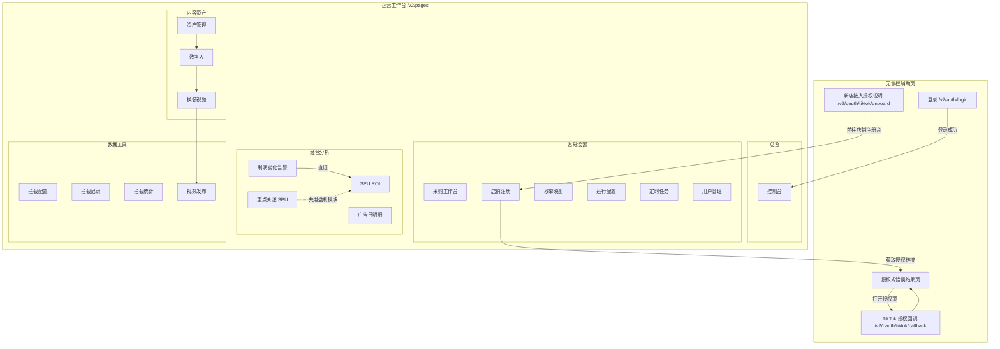
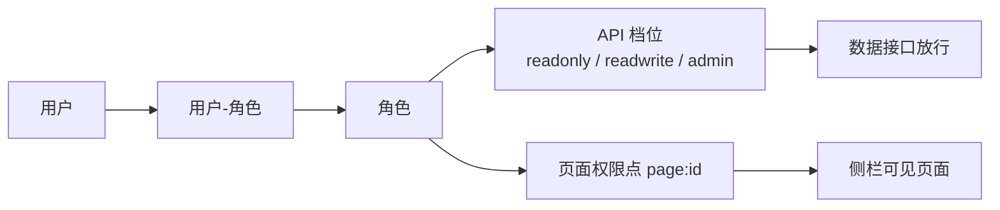
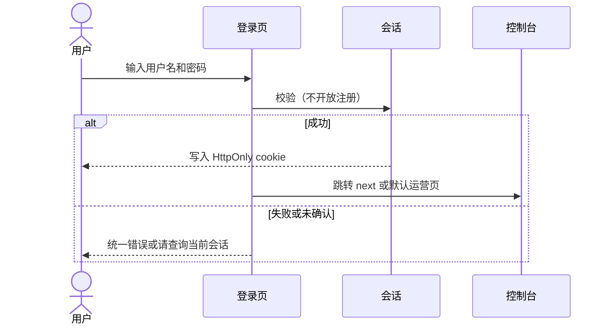
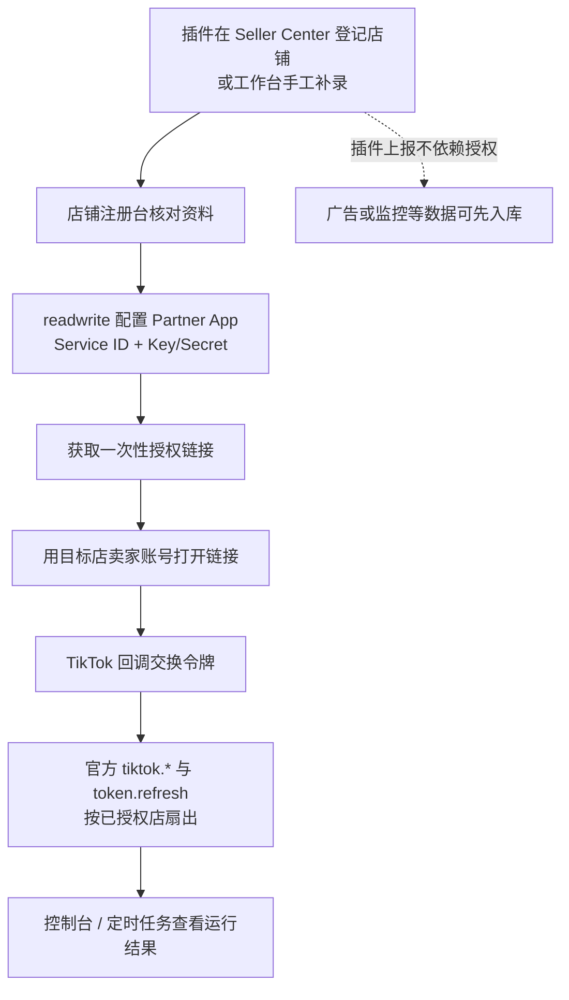
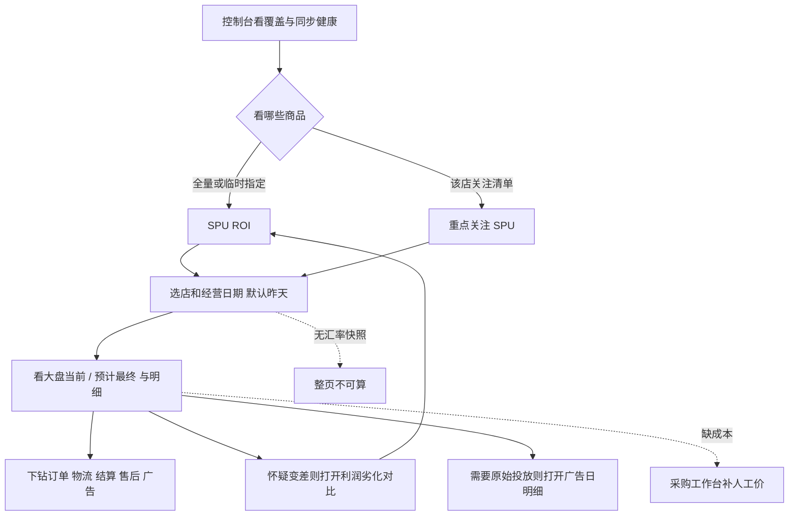
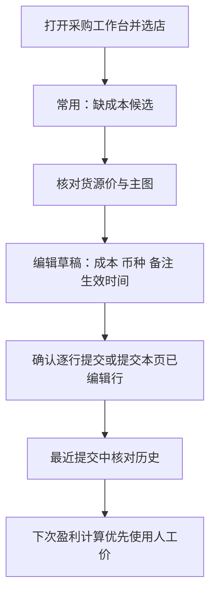
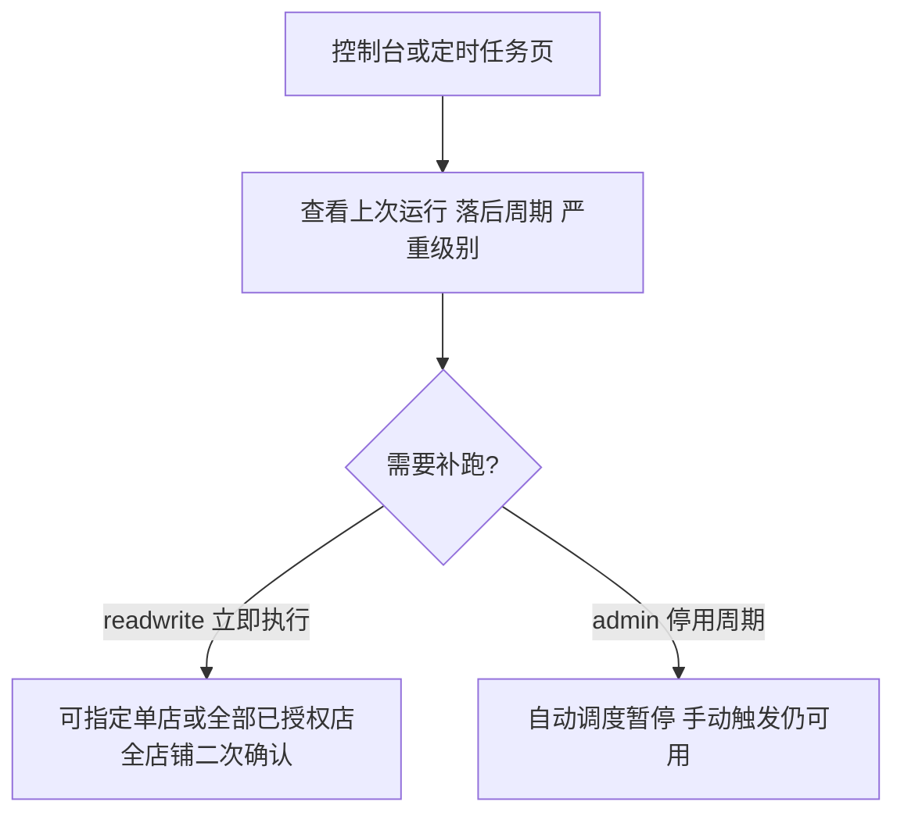
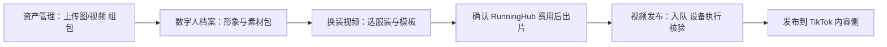

# 信息架构、导航、权限与关键流程

运营入口只有一套工作台 `/v2/pages/*`（服务端页面 + React 水合）。侧栏 18 页的文案、分组、顺序和可见性以 `tts_erp_v2/accounts/pages.py` 的 `PAGES` 与 `BUILTIN_ROLES` 为准。登录、授权说明和结果页是同一套前端的辅助页，无侧栏。

本方案包的默认描述范围是这套运营工作台。五款 Chrome 插件（广告、订单、拦截、监控、妙手捕获）作为已有采集或执行能力，在本文实体与流程中附件说明，不为插件自身界面单独出原型。插件在工作台已露出的部分（拦截三页、广告日明细、店铺插件发现、运行配置承载的监控策略等）仍按工作台页面描述。

## 1. 站点地图

没有根路径 `/` 的专用首页；日常入口是登录后的控制台。生产公网需带部署前缀（文档常见 `/tts`）。

**不要**把下列 API 能力画成现有菜单页：订单中心、售后中心、结算中心、汇率台、成本快照页、旧版利润日报页、商品实时透传页。它们只在 API 和 / 或盈利下钻中出现。

## 2. 导航结构

侧栏品牌「tts / erp」，顶栏上下文为「运营工作台 / &lt;分组&gt;」，标题为当前菜单名。可折叠侧栏。顺序即导航顺序：

| 分组 | 菜单文案 | 页面 id | 路由 |
| --- | --- | --- | --- |
| 总览 | 控制台 | dashboard | `/v2/pages/dashboard` |
| 经营分析 | 重点关注 SPU | focused-spus | `/v2/pages/focused-spus` |
| 经营分析 | SPU ROI | spu-roi | `/v2/pages/spu-roi` |
| 经营分析 | 利润劣化告警 | spu-profit-deterioration | `/v2/pages/spu-profit-deterioration` |
| 经营分析 | 广告日明细 | ad-daily | `/v2/pages/ad-daily` |
| 基础设置 | 采购工作台 | manual-costs | `/v2/pages/manual-costs` |
| 基础设置 | 店铺注册 | shops | `/v2/pages/shops` |
| 基础设置 | 枚举映射 | enum-map | `/v2/pages/enum-map` |
| 基础设置 | 运行配置 | runtime-configs | `/v2/pages/runtime-configs` |
| 基础设置 | 定时任务 | sync-jobs | `/v2/pages/sync-jobs` |
| 基础设置 | 用户管理 | users | `/v2/pages/users` |
| 数据工具 | 拦截配置 | intercept-configs | `/v2/pages/intercept-configs` |
| 数据工具 | 拦截记录 | intercept-requests | `/v2/pages/intercept-requests` |
| 数据工具 | 拦截统计 | intercept-stats | `/v2/pages/intercept-stats` |
| 数据工具 | 视频发布 | video-publish | `/v2/pages/video-publish` |
| 内容资产 | 资产管理 | media-assets | `/v2/pages/media-assets` |
| 内容资产 | 数字人 | digital-humans | `/v2/pages/digital-humans` |
| 内容资产 | 换装视频 | runninghub | `/v2/pages/runninghub` |

辅助页：

| 页面 | 路由 | 说明 |
| --- | --- | --- |
| 登录 | `/v2/auth/login` | 用户名 + 密码，无侧栏 |
| 新店接入授权说明 | `/v2/oauth/tiktok/onboard` | 跳板，引导去店铺注册台 |
| 结果说明 | 由回调等返回 | 成功 / 失败 / 授权链接，无侧栏 |
| TikTok 授权回调 | `/v2/oauth/tiktok/callback` | 卖家从 TikTok 回来的公开落点 |

## 3. 权限矩阵

权限由 **页面权限点** `page:<id>` 与 **API 档位**（readonly &lt; readwrite &lt; admin）共同决定。能进页面通常即可使用该页允许的功能，但若干接口另有档位要求。前端写按钮只是提示，真正放行以服务端为准。

### 3.1 预置角色 × 页面

| 页面 | 系统管理员 | 运营 | 只读分析 | 打开页面的额外档位 | 写操作要点 |
| --- | --- | --- | --- | --- | --- |
| 控制台 | 是 | 是 | 是 | — | 只读 |
| 重点关注 SPU | 是 | 是 | 是 | — | 改关注清单需 readwrite |
| SPU ROI | 是 | 是 | 是 | — | 只读（临时费率是查询参数） |
| 利润劣化告警 | 是 | 是 | **否** | — | 只读对比 |
| 广告日明细 | 是 | 是 | 是 | — | 只读 |
| 采购工作台 | 是 | 是 | 否 | — | 写入需 readwrite |
| 店铺注册 | 是 | 是 | 否 | — | 配置 / 授权链接需 readwrite |
| 枚举映射 | 是 | 是 | 否 | GET 可读 | **增删改需 admin**（登记表误写 readwrite，以 handler 为准） |
| 运行配置 | 是 | 是 | 否 | **打开即要求 readwrite** | 发布 / 凭证需 write |
| 定时任务 | 是 | 是 | 否 | **打开即要求 readwrite** | 手动触发 = readwrite；启停周期 = admin |
| 用户管理 | 是 | **否** | 否 | 绑定 page:users | 维护需 admin |
| 拦截配置 | 是 | 是 | 否 | **含 GET/导出均需 readwrite** | 维护规则 |
| 拦截记录 | 是 | 是 | 否 | 见策略；预置只读无此页 | 以查询详情为主 |
| 拦截统计 | 是 | 是 | 是 | — | 只读 |
| 视频发布 | 是 | **否**（需另授 page:video-publish） | 否 | 绑定页面权限 | 会发到 TikTok 内容侧 |
| 资产管理 | 是 | 是 | 否 | — | 写入需 readwrite |
| 数字人 | 是 | 是 | 否 | — | 写入需 readwrite |
| 换装视频 | 是 | 是 | 否 | 绑定 page:runninghub | 生成计费；工作流 / 账户类需 admin |

浏览器会话优先级：有效 cookie &gt; Bearer API key &gt; X-API-Key。API key 没有页面权限，供插件和脚本使用。工作台没有签发、轮换或吊销密钥的页面，实际通过命令行 `api_keys.py` 管理；完整密钥只在创建或轮换时打印一次。

### 3.2 权限概念关系

## 4. 核心实体（产品视角）

店铺是分析主范围。其下有商品 SPU、订单与订单行、履约、售后、结算、广告日明细、重点关注清单和平台费率估算。采购侧是人工成本、妙手货源价和成本快照。汇率快照是盈利换算的必备依据。

插件落库的 Chrome 订单域表与官方同步进入的 commerce / fulfillment / after_sales / finance 是两套来源，共同服务分析，**不**在工作台呈现为两套订单中心。

内容侧：媒体资产 → 素材包 → 数字人档案 → 换装批次；以及独立的视频发布任务与设备。

账号侧：用户、角色、会话；另有独立 API key 与运行配置 / 加密凭证、枚举映射、同步任务记录。

## 5. 关键用户流程

### 5.1 登录进入工作台

工作台顶栏可退出。改自己的密码目前只能走 API，页面无入口。

### 5.2 新店从发现到授权上线

`/v2/oauth/tiktok/onboard` 只解释上述路径并跳回店铺注册台，不是可完成授权的向导。

### 5.3 日常看经营与 SPU 盈利

### 5.4 人工维护采购成本

### 5.5 查看与干预同步

当前已注册的主要同步任务（产品认知，周期以调度注册表为准）：TikTok 订单 / 详情 / 商品 / 物流 / 售后 / 财务、凭证续期、汇率快照、妙手店铺与采集箱 / 货源成本 / 包裹、成本快照、旧版利润日报、SPU 主图镜像、店铺平台费率估算。已停调度的 today→daily、利润劣化每日评估器不再作为现行任务。

### 5.6 内容生产到发布（可选）

各步受页面权限和读写档位约束。预置运营默认不能进视频发布页。监控插件按规则在 Seller Center 会话关广告计划，属于另一条外部写路径，不经过本流程。

### 5.7 权限治理

管理员在用户管理中建账号、分配预置或自定义角色、必要时重置密码或吊销会话。用户自行登录。改自己的密码目前没有工作台入口。
